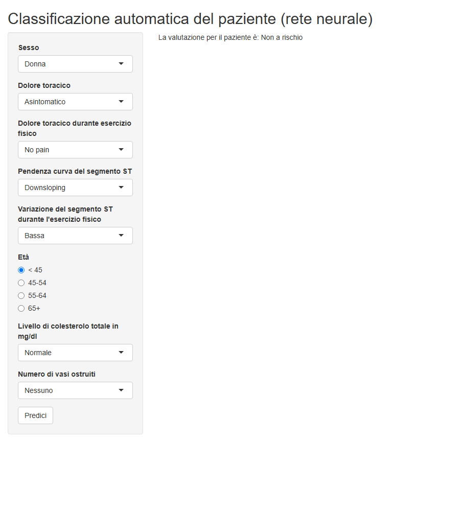

# ml-classification-R

Comparison of machine learning models in R to classify patients at risk of heart disease, and a
Shiny app that classifies a new patient with the best model.

The analysis is written and commented in Italian.

**[Open the report with the interactive app](https://cominerosbiostatistic.github.io/ml-classification-R/)**

## Contents

| File                           | Content                                                                    |
| ------------------------------ | -------------------------------------------------------------------------- |
| [`analysis.Rmd`](analysis.Rmd) | R Markdown source: code and comments                                       |
| [`app/app.R`](app/app.R)       | Shiny app that classifies a new patient as at risk or not at risk          |
| [`docs/`](docs/)               | Published website: the rendered report and the app exported with Shinylive |
| [`images/`](images/)           | Screenshot of the app                                                      |

## Steps

| Step                | What it does                                                                                        |
| ------------------- | --------------------------------------------------------------------------------------------------- |
| Exploration         | Dimensions, variable formats and distributions.                                                     |
| Recoding            | Turns every numeric variable into a categorical one, with clinical thresholds.                      |
| Imputation          | Imputes missing values with K-nearest neighbours.                                                   |
| Balance             | Checks the balance of the outcome by sex, blood pressure and cholesterol, and tests oversampling.   |
| Model selection     | Selects the variables with BIC, Mallows' Cp and adjusted R².                                        |
| Model comparison    | Compares KNN, LDA, QDA, logistic regression and a neural network over 100 random train/test splits. |
| Tuning              | Tunes the neural network with 10-fold cross-validation, maximising sensitivity.                     |
| Variable importance | Measures variable importance with `varImp` and `DALEX`.                                             |
| App                 | Saves the tuned network, without training data, and exports the Shiny app with Shinylive.           |

## App

The app runs inside the report, in the browser, with [Shinylive](https://posit-dev.github.io/r-shinylive/):
no server is needed. The first load downloads R and the packages, and can take up to a minute.

## How to run it

1. Place the dataset in `data/DATA.csv`. The data are not included in this repository.
2. Knit `analysis.Rmd` in RStudio. The report is saved as `docs/index.html`, the tuned model in
   `app/model_nn.rds`, and the app is exported to `docs/app`.
3. To run the app locally in R, use `shiny::runApp("app")`.

Packages: `DataExplorer`, `ggplot2`, `Hmisc`, `VIM`, `ROSE`, `dplyr`, `leaps`, `caret`, `nnet`,
`neuralnet`, `boot`, `MASS`, `class`, `DALEX`, `shiny`, `shinylive`.

## Limitations

- The dataset contains repeated rows. The same patient can fall both in the training and in the test
  set, so the performance estimates are optimistic.
- The model gives a large weight to the number of obstructed vessels: with at least one, most
  combinations are classified as at risk.
- The outcome in the data is coded the opposite way to its description (0 = disease). The analysis
  recodes it so that 1 identifies patients with heart disease.

## License

Released under the [MIT License](LICENSE).
